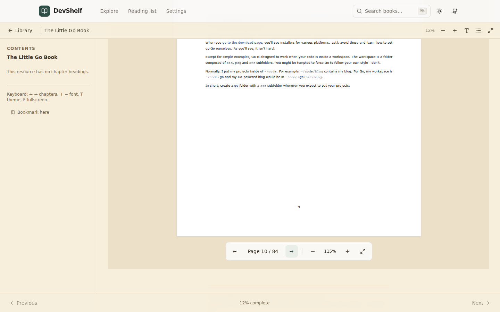
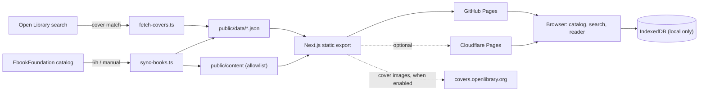

<p align="center">
  <picture>
    <source media="(prefers-color-scheme: light)" srcset="docs/assets/banner-light.svg">
    
  </picture>
</p>

<h1 align="center">DevShelf</h1>

<p align="center">
  <strong>Read the best programming books, free.</strong><br>
  A black-and-white library with one lime accent: real catalog resources, an in-app Markdown/HTML/PDF reader, and a private reading list that never leaves your browser.
</p>

<p align="center">
  
  
  
  
  
  
  
  
</p>

<p align="center">
  <a href="https://hungpt99-dev.github.io/DevShelf/"><strong>Live demo</strong></a> ·
  <a href="#screenshots">Screenshots</a> ·
  <a href="#quick-start">Quick start</a> ·
  <a href="#what-it-does">What it does</a> ·
  <a href="#automation">Automation</a> ·
  <a href="#documentation">Docs</a> ·
  <a href="#status">Status</a>
</p>

---

Book catalogs are easy to find and hard to use. Links are scattered across Markdown files, formats are unclear, and most readers send you straight back to an external site. DevShelf turns the [EbookFoundation/free-programming-books](https://github.com/EbookFoundation/free-programming-books) catalog into a searchable library with a real reading interface — without adding a server.

Every record keeps its original URL, source file, line and heading. Titles, authors, formats and licenses are extracted from the source; anything the catalog does not say stays `unknown` or empty. Books that cannot be rendered locally open their original source instead of pretending to be readable.

> **The catalog is the source of truth. The browser is the only place your reading state lives.**

## Screenshots

<p align="center">
  
  
</p>
<p align="center"><sub>Homepage with live sync chip and book covers · Catalog with 4,735 resources, one real Open Library cover and local filters</sub></p>

<p align="center">
  
  
</p>
<p align="center"><sub>Markdown reader with 226-chapter TOC and code-block tools · PDF reader showing page 10 of 84</sub></p>

All four images are captures of the current static export, regenerated with `npm run capture:screenshots http://127.0.0.1:4173/DevShelf` after the Phase 0 reader fixes. The live demo is deployed by the sync workflow; it may trail the latest commit until that workflow runs.

## Quick start

DevShelf is published as a GitHub repository and a static GitHub Pages site — there is no npm package to install.

```bash
git clone https://github.com/hungpt99-dev/DevShelf.git
cd DevShelf
npm ci
npm run dev          # http://localhost:3000
```

Generated indexes are committed, so the app runs immediately. To refresh from upstream:

```bash
npm run sync          # parse the real catalog and regenerate public/data/*.json
npm run sync:covers   # match covers from Open Library (polite, resumable)
npm run validate:data # verify indexes, attribution and bundled content
```

## What it does

| Stage | What happens | Who decides |
| --- | --- | --- |
| **Ingest** | One pinned tarball of the upstream repository is parsed into normalized JSON; duplicates merge by stable ID. | Deterministic parser |
| **Discover** | Local Fuse.js index powers instant search; filters cover language, category, format and reading availability. | Your query, in your browser |
| **Covers** | Open Library matches are resolved at build time; strict title/author matching, generated art and a static SVG cover fill the gaps. | Validated match + your Settings toggle |
| **Read** | Markdown, HTML and PDF providers render allowlisted content; everything else links to its original source. | Validated resource metadata |
| **Remember** | Progress, bookmarks, list status and preferences are stored in Dexie/IndexedDB. | You, locally |
| **Refresh** | A CI workflow detects upstream commits, validates data, commits changes and redeploys. | Upstream commit + schedule |

## Surfaces

| Surface | Role | What it adds |
| --- | --- | --- |
| Home | Book-cover-first entry point | Sync chip, real or generated covers, catalog stats, deterministic featured shelves |
| Explore | Full catalog | Shareable URL filters, search, sort, availability, license, load-more, honest empty states |
| Book detail | Provenance | Source file/line, license when stated, alternate links, related books |
| Reader | Distraction-free reading | TOC, themes, font controls, keyboard nav, copyable code blocks, PDF zoom/pages, saved position |
| Reading list | Local personal library | Shelves, tags, notes, ratings, dates, filtering/sorting, Markdown/JSON export |
| Paths | Guided reading | Six curated sequences from real catalog ids with local progress |
| New and changelog | History view | Weekly additions from sync history, Atom feed and changelog |
| Shared | Serverless sharing | Read-only compressed hash payload with import to local list |
| Settings | Preferences and data | Theme, font, width, line height, sidebar, language, opt-in toggles, JSON v2 export/import |

## Measured

| Metric | Value | How to reproduce |
| --- | ---: | --- |
| Books from source | 4,735 | `npm run validate:data` |
| Categories / languages | 498 / 46 | `public/data/metadata.json` |
| Bundled readable books | 3 | `public/data/readable.json` |
| Unit tests | 59 passing | `npm test` |
| Static build | exit code 0; 9,488 static pages | `npm run build` (output in `out/`) |
| HTTP smoke checks | 35/35 | `npm run smoke` against a local `out/` server |
| Cover matches in snapshot | 1 | `Object.keys(require("./public/data/covers.json")).length` |

Counts are derived from the committed catalog snapshot, not typed into the UI. The homepage reads the same files.

## Configuration

| File | Controls | Guide |
| --- | --- | --- |
| `scripts/reading-sources.json` | The only books whose content may be bundled; preserves catalog link, raw download URL, attribution and license | [docs/DATA_SOURCES.md](docs/DATA_SOURCES.md) |
| `.github/workflows/sync-books.yml` | 6-hour schedule, manual dispatch, validation, GitHub Pages and optional Cloudflare deployment | [docs/DEPLOYMENT.md](docs/DEPLOYMENT.md) |
| `next.config.ts` | Static export and optional `NEXT_PUBLIC_BASE_PATH` for project Pages sites | [docs/DEPLOYMENT.md](docs/DEPLOYMENT.md) |
| `public/data/*.json` | Generated catalog, categories, languages, readable map, metadata, sync history and cover URLs | [ARCHITECTURE.md](ARCHITECTURE.md) |
| `scripts/cache/cover-misses.json` | Cover lookups that found no safe match; retried after 30 days or with `--force` | [docs/DATA_SOURCES.md](docs/DATA_SOURCES.md) |
| `data/paths/*.json` | Six curated learning paths with real book ids and schema | [docs/paths.md](docs/paths.md) |
| `public/data/link-health.json` | Weekly external URL status with consecutive-failure counts | [docs/link-health.md](docs/link-health.md) |
| `public/images/default-cover.svg` | Static last-resort cover when generation cannot run | [docs/DATA_SOURCES.md](docs/DATA_SOURCES.md) |
| `docs/assets/` | Product mark and light/dark README banners | [README](#screenshots) |

## Automation

The sync workflow runs every 6 hours and on manual dispatch (`force=true` rebuilds without an upstream change):

1. `git ls-remote` resolves the upstream `main` SHA and compares it with `metadata.json.commit`.
2. A tarball pinned to that SHA is parsed; added, updated and removed records are diffed by stable ID.
3. All indexes and the sync report are regenerated; `npm run validate:data` gates deployment.
4. `npm run sync:covers` matches a bounded batch of new books against Open Library, caches misses and writes `public/data/covers.json`. A covers-only change still commits and redeploys.
5. Except on forced manual runs, the dataset is committed and Pages are rebuilt only when records change. With `CLOUDFLARE_API_TOKEN` and `CLOUDFLARE_ACCOUNT_ID` set as repo secrets, the workflow also rebuilds for the site root and deploys to Cloudflare Pages (`devshelf-hungpt99`).

Network or parse failures stop before any file is written, so the last known good dataset and deployment stay live. Catalog data comes only from same-origin static files; matched cover images come from Open Library when the Settings toggle is on. The app does not call GitHub or require API tokens at runtime. Outbound book links open the original resource in a new tab. No token is present in frontend code — credentials exist only in the Actions runner. Cloudflare setup details are in [docs/DEPLOYMENT.md](docs/DEPLOYMENT.md).

## Documentation

| | |
| --- | --- |
| **Using it** | [Live demo](https://hungpt99-dev.github.io/DevShelf/) · [Reading list](docs/reading-list.md) · [Reading companion](docs/reading-companion.md) · [Learning paths](docs/paths.md) · [Sharing](docs/sharing.md) · [Deployment](docs/DEPLOYMENT.md) |
| **Trusting it** | [Data sources & attribution](docs/DATA_SOURCES.md) · [Sync report](scripts/reports/sync-report.md) · [MIT license](LICENSE) |
| **Building on it** | [Architecture](ARCHITECTURE.md) · [Feature plan](docs/PLAN-features.md) · [UI localization](docs/i18n.md) · [URL filters](docs/filters.md) · [Parser](scripts/lib/parse-books.ts) · [Reader providers](src/lib/readers/providers.ts) |
| **Operating it** | [Sync workflow](.github/workflows/sync-books.yml) · [Link health](docs/link-health.md) · [Cover fetcher](scripts/fetch-covers.ts) · [Validation script](scripts/validate-data.ts) · [Screenshot capture](scripts/capture-screenshots.mjs) |

## Architecture



**Boundary rule:** catalog JSON and generated art come from same-origin static files; cover images are the one intentional third-party request, and only when enabled. Catalog writes happen in CI; user state writes happen only in IndexedDB. Neither side calls the other at runtime.

## Status

| Area | State |
| --- | --- |
| Phased feature plan | **Complete** — Phases 0–4 verified locally ([plan](docs/PLAN-features.md)) |
| Catalog ingestion, IDs, dedupe, diff history | **Implemented** — deterministic parser with unit tests |
| Black/white/lime UI with generated covers | **Implemented** — verified at 375, 768 and 1280 px |
| Search, filters, book details, related books | **Implemented** — entirely client-side |
| Markdown reader | **Implemented** — 226-chapter TOC in the bundled Clean ABAP book |
| HTML reader | **Implemented** — sanitized DOM with a 50-chapter TOC |
| PDF reader | **Implemented** — canvas pages, text layer, selection annotations, zoom, fullscreen, saved page |
| External resources | **Implemented** — detail page links to the original source; never scraped |
| Progress, bookmarks, preferences, export/import | **Implemented** — Dexie/IndexedDB, no account |
| Reading list v2 | **Implemented** — Dexie v2 migration, shelves, tags, notes, ratings, dates, filters and exports |
| Learning paths | **Implemented** — six paths seeded from real ids, schema validated at build time |
| Serverless sharing | **Implemented** — compressed hash payload, `/shared` preview and local import |
| Edition grouping | **Implemented** — 149 grouped works in the committed snapshot, readable edition first |
| Link health | **Implemented** — weekly CI check, two-failure rule, catalog filter and issue link |
| New page and Atom feed | **Implemented** — weekly history groups, `feed.xml` and changelog page |
| Contribute buttons | **Implemented** — issue templates and prefilled links from the book page and footer |
| Scheduled sync + conditional GitHub Pages deploy | **Implemented** — Pages live on the last deployed head; current head awaits the next workflow run |
| URL-driven filters and i18n | **Implemented** — shareable query params, browser-language default, English/Vietnamese UI catalogs |
| Export/import v3 | **Implemented** — v3 adds highlights and sessions; v1 and v2 still import, with migration tests |
| Offline mode | **Implemented** — opt-in service worker, bundled-book caching, update notice, clear-offline action |
| Reader display regressions | **Implemented** — theme tokens and fenced-code wrapper fixed; smoke guards TOC and chapter navigation |
| Real cover images | **Partial** — strict Open Library matching; one match in the committed snapshot, generated covers fill the rest |
| Cover fallback chain | **Implemented** — real image → generated art → static default SVG; verified on image error, 1×1 responses, empty titles and opt-out |
| Source-provided cover metadata | **Implemented** — descriptions/years/pages/ISBN only when Open Library supplies them, with source link; never invented |
| SEO and feed | **Implemented** — per-book OG images, JSON-LD, canonical URLs, sitemap, robots and Atom feed |
| Reading stats | **Implemented** — opt-in sessions, weekly minutes, streaks, heatmap, goal and delete action |
| Highlights and notes | **Implemented** — selection highlights with relocation, private notes, jump-to-chapter and Markdown export |
| Optional gist sync | **Implemented** — opt-in, off by default; only book ids/statuses/timestamps are uploaded to a secret gist; token encrypted locally and excluded from exports |
| Recently added shelf | **Implemented** — real sync history; honest empty state when a sync adds nothing |
| Cloudflare Pages deploy | **Partial** — secrets and steps are wired, but the deploy fails with auth code 10000 until the token also has `User → User Details:Read` and `User → Memberships:Read` |
| Accounts, cloud sync, runtime scraping | **Not implemented by design** — no backend and no site access bypass; the optional gist sync is user-initiated and off by default |

## Security and privacy

- No backend, REST API, database server, authentication or analytics.
- Search queries and reading positions never leave the browser.
- With cover images enabled (the default), the browser requests matched images from `covers.openlibrary.org` — a third party. Turn this off in Settings to use generated covers only; no external image request is then made. Cover images are courtesy of [Open Library](https://openlibrary.org/).
- Offline mode is off by default. When enabled, the service worker caches only same-origin static pages and the three allowlisted bundled books; it never caches catalog JSON or external resources.
- Optional gist sync is off by default and user-initiated. You must preview the upload before the first sync; only book ids, statuses and timestamps are sent. The GitHub token is encrypted with AES-GCM using a passphrase you supply, stored only in IndexedDB, and excluded from exports. There is no password recovery.
- `GITHUB_TOKEN` and Cloudflare credentials exist only inside the Actions runner; nothing token-like ships to `out/`.
- Synchronization touches only `public/data/` and allowlisted `public/content/`; IndexedDB user data is never modified.
- Bundled HTML is sanitized with DOMPurify; external links use `rel="noopener noreferrer"`.
- Share hashes contain only book ids and statuses, never notes or personal data. Link checks run in CI with a repo-identifying User-Agent; the browser never probes external URLs.

## Development

```bash
npm ci
npm run validate:data
npm test
npm run typecheck
npm run lint
npm run build
npm run check:readme
npm start            # or: node scripts/serve-static.mjs out 4173 /DevShelf
```

## Evidence

- GitHub Actions: green sync/deploy run `44887877659` on an earlier head; run `44889512574` deployed the restyled site to GitHub Pages, then failed only at the optional Cloudflare step (token permissions, see Status). The current head `684e0a4` has not had its own workflow run yet.
- Local static export verified with `npm run build` (exit 0, 9,477 pages) and `npm run smoke` (21/21, including reader TOC and chapter-navigation guards). The live demo serves the last deployed sync; the cover dataset is in the repo and will appear after the next workflow deploy.
- Browser verification: 4,735 resources load; Markdown, HTML and PDF readers render; progress survives reload; settings export/import round-trips; light/dark themes and the 375/768/1280 layouts were reviewed.
- Cover verification: a real Open Library image loads, aborted and 1×1 responses fall back to generated art, an empty title uses the static SVG, and turning the setting off produced zero Open Library requests.
- Phase 0 verification: fenced code renders inside `<pre>`, duplicate heading ids stay unique, and active TOC contrast measured 18.88:1 with app theme light and reader theme dark.
- Phase 1 verification: browser-language default resolved to Vietnamese, "All languages" wrote `lang=all`, search wrote `q=go`, browser back cleared it; switching to Vietnamese updated `document.documentElement.lang` and the navigation labels.
- Phase 2 verification: six paths validate against real catalog ids; 149 works grouped into editions; a compressed share hash round-tripped through `/shared` with an import action; link health seeded with 5 checked URLs; 30/30 smoke checks cover the new routes and feed.
- Phase 3/4 verification: 59 unit tests cover highlight anchors, reading time, stats, PDF rectangles, gist merge and token encryption; build emits 4,735 OG images plus sitemap/robots in 935 ms; 35/35 smoke checks cover `/stats`, manifest, sitemap, robots and the service worker. Route JS after lazy-loading the highlight layer: home 902.0 KB, books 925.5 KB, reader 1,232.2 KB (before Phases 3–4: 895.2 / 918.7 / 1,225.8 KB).

## Roadmap

- Run the sync workflow once on the current head to publish the Phase 0–4 changes to GitHub Pages.
- Grant the missing Cloudflare token permissions and rerun the workflow with `force=true`.
- Expand the optional sync to conflict resolution chosen explicitly per book.
- Expand the reading allowlist with more explicitly licensed source-linked books.
- Optional custom domain and pagination/virtualization tuning for slower devices.

## License

DevShelf source code is [MIT licensed](LICENSE). The upstream catalog is [CC BY 4.0](https://creativecommons.org/licenses/by/4.0/); each bundled book keeps its own license and attribution, shown in the reader. Cover images are courtesy of [Open Library](https://openlibrary.org/). See [docs/DATA_SOURCES.md](docs/DATA_SOURCES.md).
