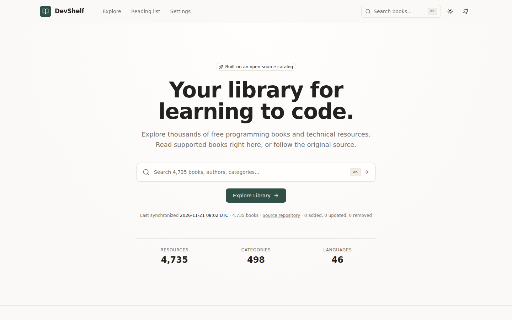
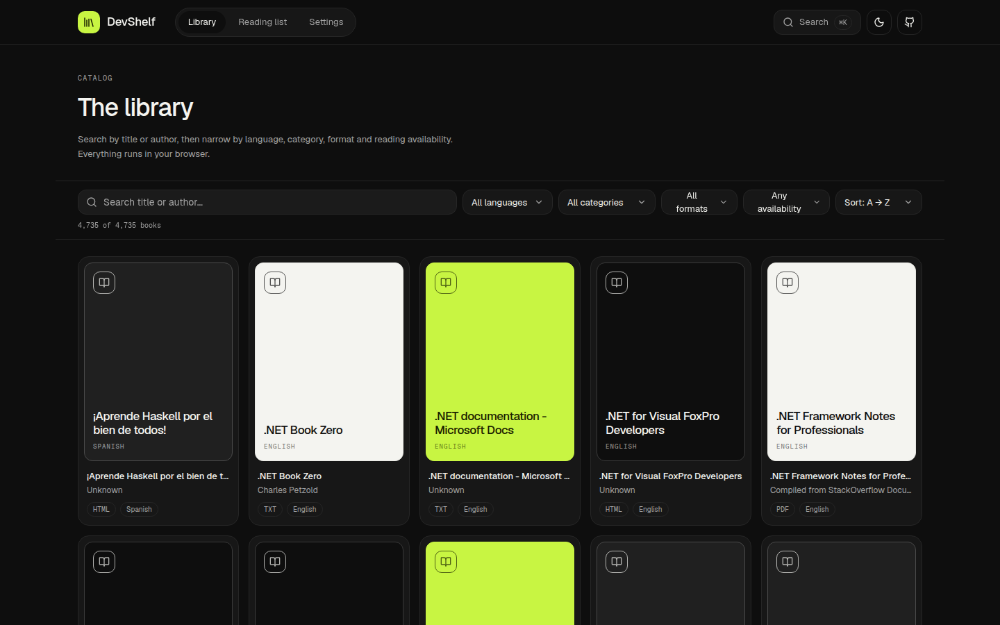
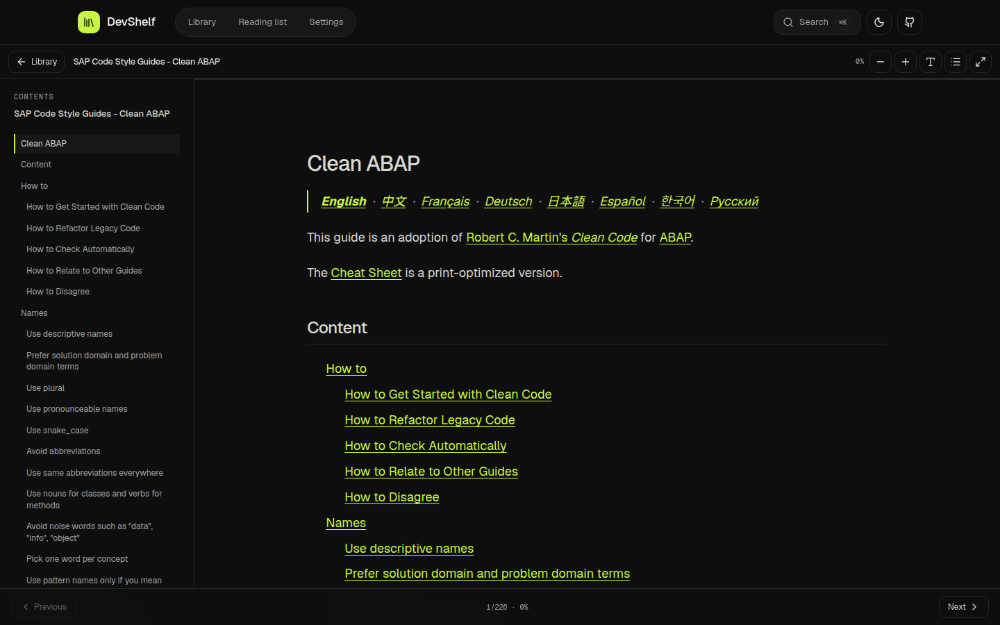
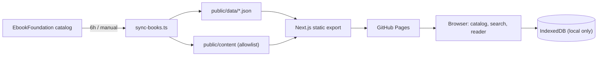

<p align="center">
  <picture>
    <source media="(prefers-color-scheme: light)" srcset="docs/assets/banner-light.svg">
    
  </picture>
</p>

<h1 align="center">DevShelf</h1>

<p align="center">
  <strong>A free programming books library and reader, built from open data.</strong><br>
  Thousands of real catalog resources, an in-app Markdown/HTML/PDF reader, and a private reading list that never leaves your browser.
</p>

<p align="center">
  <a href="https://github.com/hungpt99-dev/DevShelf/actions/workflows/sync-books.yml"></a>
  
  
  
  
  
  
  
</p>

<p align="center">
  <a href="https://hungpt99-dev.github.io/DevShelf/"><strong>Live demo</strong></a> ·
  <a href="#screenshots">Screenshots</a> ·
  <a href="#quick-start">Quick start</a> ·
  <a href="#what-it-does">What it does</a> ·
  <a href="#automation">Automation</a> ·
  <a href="#documentation">Docs</a> ·
  <a href="#status">Status</a>
</p>

---

Book catalogs are easy to find and hard to use. Links are scattered across Markdown files, formats are unclear, and most readers send you straight back to an external site. DevShelf turns the [EbookFoundation/free-programming-books](https://github.com/EbookFoundation/free-programming-books) catalog into a searchable library with a real reading interface — without adding a server.

Every record keeps its original URL, source file, line and heading. Titles, authors, formats and licenses are extracted from the source; anything the catalog does not say stays `unknown` or empty. Books that cannot be rendered locally open their original source instead of pretending to be readable.

> **The catalog is the source of truth. The browser is the only place your reading state lives.**

## Screenshots

<p align="center">
  
  
</p>
<p align="center"><sub>Homepage with sync status · Catalog with 4,735 resources and local filters</sub></p>

<p align="center">
  
  
</p>
<p align="center"><sub>Markdown reader with 226-chapter TOC · PDF reader with page controls</sub></p>

All four images are captures of the deployed site at [hungpt99-dev.github.io/DevShelf](https://hungpt99-dev.github.io/DevShelf/), regenerated with `node scripts/capture-screenshots.mjs`.

## Quick start

DevShelf is published as a GitHub repository and a static GitHub Pages site — there is no npm package to install.

```bash
git clone https://github.com/hungpt99-dev/DevShelf.git
cd DevShelf
npm ci
npm run dev          # http://localhost:3000
```

Generated indexes are committed, so the app runs immediately. To refresh from upstream:

```bash
npm run sync          # parse the real catalog and regenerate public/data/*.json
npm run validate:data # verify indexes, attribution and bundled content
```

## What it does

| Stage | What happens | Who decides |
| --- | --- | --- |
| **Ingest** | One pinned tarball of the upstream repository is parsed into normalized JSON; duplicates merge by stable ID. | Deterministic parser |
| **Discover** | Local Fuse.js index powers instant search; filters cover language, category, format and reading availability. | Your query, in your browser |
| **Read** | Markdown, HTML and PDF providers render allowlisted content; everything else links to its original source. | Validated resource metadata |
| **Remember** | Progress, bookmarks, list status and preferences are stored in Dexie/IndexedDB. | You, locally |
| **Refresh** | A CI workflow detects upstream commits, validates data, commits changes and redeploys. | Upstream commit + schedule |

## Surfaces

| Surface | Role | What it adds |
| --- | --- | --- |
| Home | Editorial entry point | Last sync timestamp, totals, source link, curated deterministic picks |
| Explore | Full catalog | Search, filters, sort, availability, load-more, honest empty states |
| Book detail | Provenance | Source file/line, license when stated, alternate links, related books |
| Reader | Distraction-free reading | TOC, themes, font controls, keyboard nav, PDF zoom/pages, saved position |
| Reading list | Local personal library | Saved / reading / completed, progress, continue reading, remove |
| Settings | Preferences and data | Theme, font, width, line height, sidebar, JSON export/import |

## Measured

| Metric | Value | How to reproduce |
| --- | ---: | --- |
| Books from source | 4,735 | `npm run validate:data` |
| Categories / languages | 498 / 46 | `public/data/metadata.json` |
| Bundled readable books | 3 | `public/data/readable.json` |
| Unit tests | 8 passing | `npm test` |
| Static build | exits 0 | `npm run build` (output in `out/`) |
| HTTP smoke checks | 19/19 | `npm run smoke` against a local `out/` server |

Counts are derived from the committed catalog snapshot, not typed into the UI. The homepage reads the same files.

## Configuration

| File | Controls | Guide |
| --- | --- | --- |
| `scripts/reading-sources.json` | The only books whose content may be bundled; preserves catalog link, raw download URL, attribution and license | [docs/DATA_SOURCES.md](docs/DATA_SOURCES.md) |
| `.github/workflows/sync-books.yml` | 6-hour schedule, manual dispatch, validation and Pages deployment | [docs/DEPLOYMENT.md](docs/DEPLOYMENT.md) |
| `next.config.ts` | Static export and optional `NEXT_PUBLIC_BASE_PATH` for project Pages sites | [docs/DEPLOYMENT.md](docs/DEPLOYMENT.md) |
| `public/data/*.json` | Generated catalog, categories, languages, readable map, metadata and sync history | [ARCHITECTURE.md](ARCHITECTURE.md) |

## Automation

The sync workflow runs every 6 hours and on manual dispatch (`force=true` rebuilds without an upstream change):

1. `git ls-remote` resolves the upstream `main` SHA and compares it with `metadata.json.commit`.
2. A tarball pinned to that SHA is parsed; added, updated and removed records are diffed by stable ID.
3. All indexes and the sync report are regenerated; `npm run validate:data` gates deployment.
4. Only when something changed are the dataset committed, the site built and GitHub Pages redeployed. With `CLOUDFLARE_API_TOKEN` and `CLOUDFLARE_ACCOUNT_ID` set as repo secrets, the workflow rebuilds for the site root and also deploys to Cloudflare Pages (`devshelf-hungpt99`).

Network or parse failures stop before any file is written, so the last known good dataset and deployment stay live. The browser never calls GitHub or any API, and no token is present in frontend code — credentials exist only in the Actions runner. Cloudflare setup details are in [docs/DEPLOYMENT.md](docs/DEPLOYMENT.md).

## Documentation

| | |
| --- | --- |
| **Using it** | [Live demo](https://hungpt99-dev.github.io/DevShelf/) · [Deployment](docs/DEPLOYMENT.md) |
| **Trusting it** | [Data sources & attribution](docs/DATA_SOURCES.md) · [Sync report](scripts/reports/sync-report.md) · [MIT license](LICENSE) |
| **Building on it** | [Architecture](ARCHITECTURE.md) · [Parser](scripts/lib/parse-books.ts) · [Reader providers](src/lib/readers/providers.ts) |
| **Operating it** | [Sync workflow](.github/workflows/sync-books.yml) · [Validation script](scripts/validate-data.ts) |

## Architecture



**Boundary rule:** the frontend fetches only same-origin static files. Catalog writes happen in CI; user state writes happen only in IndexedDB. Neither side calls the other at runtime.

## Status

| Area | State |
| --- | --- |
| Catalog ingestion, IDs, dedupe, diff history | **Implemented** — deterministic parser with 8 unit tests |
| Search, filters, book details, related books | **Implemented** — entirely client-side |
| Markdown reader | **Implemented** — 226-chapter TOC in the bundled Clean ABAP book |
| HTML reader | **Implemented** — sanitized DOM with a 50-chapter TOC |
| PDF reader | **Implemented** — canvas pages, zoom, fullscreen, saved page; no text-selection layer yet |
| External resources | **Implemented** — detail page links to the original source; never scraped |
| Progress, bookmarks, preferences, export/import | **Implemented** — Dexie/IndexedDB, no account |
| Scheduled sync + conditional Pages deploy | **Implemented** — green workflow on the current head |
| Recently added before automation | **Partial** — first snapshot has no prior baseline; history grows each sync |
| PDF text layer and annotations | **Not implemented** — canvas rendering only; page navigation works |
| Accounts, cloud sync, runtime scraping | **Not implemented by design** — no backend and no site access bypass |
| Descriptions, covers, ratings, popularity | **Not implemented** — the source catalog does not provide them |

## Security and privacy

- No backend, REST API, database server, authentication or analytics.
- Search queries and reading positions never leave the browser.
- `GITHUB_TOKEN` exists only inside the Actions runner; nothing token-like ships to `out/`.
- Synchronization touches only `public/data/` and allowlisted `public/content/`; IndexedDB user data is never modified.
- Bundled HTML is sanitized with DOMPurify; external links use `rel="noopener noreferrer"`.

## Development

```bash
npm ci
npm run validate:data
npm test
npm run typecheck
npm run lint
npm run build
npm run check:readme
npm start            # or: node scripts/serve-static.mjs out 4173 /DevShelf
```

## Evidence

- GitHub Actions: successful forced sync/deploy run `44881785530` and later green validation runs on the current head.
- `npm run smoke` against the served static export: 19/19 checks.
- Browser verification: catalog loads 4,735 resources; Markdown, HTML and PDF readers render; progress survives reload; settings export/import round-trips.

## Roadmap

- PDF text layer and annotation rendering.
- Expand the reading allowlist with more explicitly licensed source-linked books.
- Optional custom domain and pagination/virtualization tuning for slower devices.

## License

DevShelf source code is [MIT licensed](LICENSE). The upstream catalog is [CC BY 4.0](https://creativecommons.org/licenses/by/4.0/); each bundled book keeps its own license and attribution, shown in the reader. See [docs/DATA_SOURCES.md](docs/DATA_SOURCES.md).
